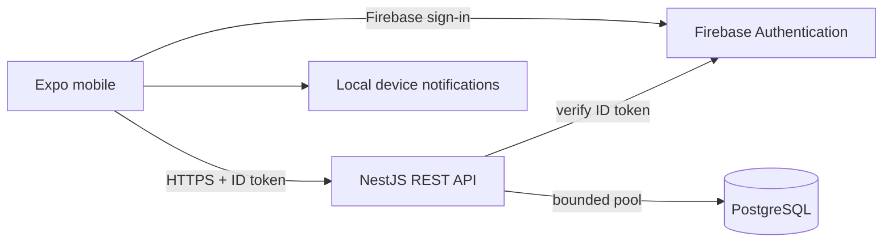

# Architecture

## Proposal

One Expo application and one stateless NestJS API, backed by PostgreSQL. Use a modular monolith so a small team can deploy and debug one service. Firebase owns credentials; the API owns users, habits, versions, and raw entries. Local device notifications cover MVP reminders. No Redis or message broker at launch.

## Boundaries

Controllers validate transport input; application services coordinate transactions; domain functions calculate calendar/progress rules; repositories enforce ownership in every query. Firebase and Prisma remain adapters. Shared contracts contain no Nest, Prisma, or React imports. UI state lives in Zustand; server state will live in TanStack Query. Never store tokens in Zustand or AsyncStorage; use Firebase's supported session persistence and platform secure storage where appropriate.

Implemented modules: HealthModule, DatabaseModule, configuration and HTTP infrastructure. Planned feature modules: Auth, Users, Habits, HabitEntries, Statistics. Reminder scheduling primarily belongs to the mobile application; the API persists preferences as part of habit configuration, without a separate reminder service until needed.

## Authorization and deletion (Phase 2 acceptance gate)

Verify Firebase issuer, audience, signature, expiry, and revocation on sensitive actions; obtain identity only from the verified token. Every repository operation includes `userId`. Entry writes first lock an owned habit in a transaction, resolve its applicable version, then upsert the unique date. Return 404 for resources belonging to another user. Never accept a user ID from request bodies. Test cross-user reads and mutations before enabling any feature endpoints.

Account deletion requires recent Firebase authentication. Mark the account deletion-pending, revoke sessions, delete the Firebase identity, then cascade-delete application data. Retrying must recover from either external step failing. Do not claim atomicity across Firebase and PostgreSQL. Keep only operational retry metadata with a bounded retention policy. This workflow is designed, not implemented in Phase 1.

## Operations

Validate environment at boot; enforce JSON body bounds, explicit CORS origins, rate limits, safe errors, and request IDs. Log method, route, status, duration and request ID only: no tokens, email, query strings, or body. One Node process per container with graceful shutdown. Readiness checks DB connectivity; liveness does not. An environment-backed Prisma pool has a bounded maximum and timeouts. A reverse proxy must handle TLS and, before horizontal production deployment, shared ingress rate limiting.

## Major risks

Historical recurrence and target edits, DST, mobile offline conflicts, OAuth redirect configuration, Android notification channels and iOS permission behavior require explicit tests. The first increment deliberately isolates local preview data; there is no pretend authentication or silent remote fallback. The proposed API must pass persistence and authorization gates before connecting the mobile client.

Technology versions are pinned in the lockfile. Expo's compatibility map determines native versions. Consult the [Expo SDK reference](https://docs.expo.dev/versions/latest/), [Nest migration guide](https://docs.nestjs.com/migration-guide), and [Prisma configuration reference](https://www.prisma.io/docs/orm/v7/reference/prisma-config-reference) when upgrading; upgrade one layer at a time.
