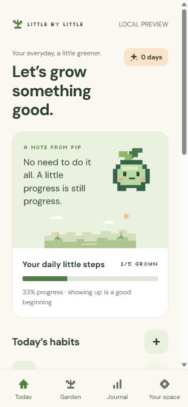
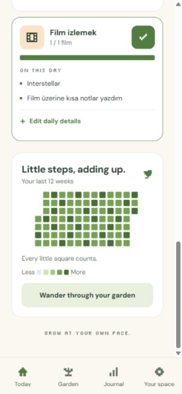
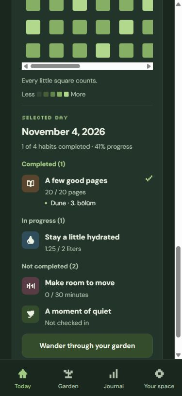

# Phase 1 validation · 2026-11-04

Local environment: Windows, Node 24.22.2 for final checks, Expo SDK 58, PostgreSQL 17 in Docker. The initial workspace was empty. The project now has its own Git repository on `codex/foundation`; unrelated parent-repository files were not changed. No production deployment or external account configuration was performed.

## Actual results

| Check                          | Result                                                                                                                                                                                                                                                 |
| ------------------------------ | ------------------------------------------------------------------------------------------------------------------------------------------------------------------------------------------------------------------------------------------------------ |
| `npm run check`                | Passed: Prisma generation, strict TypeScript across workspaces, ESLint, Prettier, tests and API smoke                                                                                                                                                  |
| Shared/API unit tests (Vitest) | 11 passed: calendar/DST, bounded ranges, normalized completion, historical versions, entry validation, streaks and safe startup configuration                                                                                                          |
| Mobile tests (Jest/Expo)       | 7 passed: numeric over-target editing, invalid/error states, binary undo, local upsert/versioning, archive behavior, storage failure and onboarding-to-creation navigation                                                                             |
| PostgreSQL integration script  | Passed against `pixel_test`: migration, overlap exclusion, targets/recurrence, duplicate prevention, cross-habit version FK, historical target lookup, raw quantities, idempotent upsert and cascade cleanup                                           |
| API HTTP smoke                 | Passed: liveness, 503 readiness without DB, safe 404, security/request-ID headers, CORS, 16 KiB body bound and 429 rate limiting                                                                                                                       |
| Production API container       | Built and booted with read-only filesystem, non-root UID 1000 and PostgreSQL connection; `/v1/health/ready` returned 200; `/docs` returned 404; runtime excluded ESLint                                                                                |
| `npm run build:web`            | Passed; only the four used font weights are exported                                                                                                                                                                                                   |
| Expo Doctor                    | 20/20 checks passed                                                                                                                                                                                                                                    |
| Browser interaction QA         | Passed for sample onboarding, creation, check-in/undo, 2.75/2 liters preserved after reload, target changes retaining 20-page historical goal, past-day edit to 35/20, archive confirmation/history, month/year navigation, Journal periods and themes |
| Responsive inspection          | Inspected 320, 375 and desktop widths. Journal page width matched 320 without horizontal page overflow; the 375 calendar exposes all seven columns. Narrow calendars/maps use horizontal scrolling to preserve touch targets                           |

The temporary production API check container was removed. The local PostgreSQL service remains available on loopback port 55432. The browser export can be served on loopback port 8081 with `npm run preview:web`. Private local credentials are in ignored `.env`, not application source.

## Limits and remaining work

This is a working local foundation, not a production-complete application. Firebase email/Google sign-in, token guards, remote feature endpoints, database application repositories, cloud sync, account deletion orchestration, SQL statistics endpoints and native notification scheduling are not implemented. The schema and SQL constraints are real; future repositories must still enforce owner, local date, recurrence, lifetime and effective-version consistency transactionally.

No iOS/Android device or signed build was tested. VoiceOver/TalkBack, large text, reduced-motion changes on a physical device, decimal keyboard behavior, safe areas, notification permissions/timezones and native performance remain release gates. Browser QA and native component mocks do not establish device compatibility. Companion idle behavior and reactions have a foundation implementation; full animation polish belongs to Phase 4/7.

Current/longest streaks shown in the local Journal are bounded to the past year and labeled accordingly. Habit-detail consistency is labeled for the last 12 weeks. Quantities above target are preserved. The local data adapter is intentionally separate from a future authenticated Query client; there is no API authentication bypass.

The GitHub Actions workflow has not run remotely. The k6 health-only scenario is provided but no load test was run. No request capacity, native frame-rate, production latency or 100,000-user readiness claim has been measured.

## Dependency maintenance

The scoped `npm audit --omit=dev --workspace=@little/api` reported **0 vulnerabilities**. The workspace lockfile audit still reports low/moderate findings in the mobile/build/test dependency tree, including transitive minimatch/glob/deepmerge paths. No high/critical finding was reported in that audit. ESLint 9 also receives an upstream out-of-support notice. Upgrade the lint/tooling stack and review compatible upstream fixes and reachability before release; do not force incompatible Expo or Jest downgrades merely to change the audit count. This foundation is not a security-audit certificate.

## Preview

## Daily-details follow-up · 2026-11-04

Daily entries now accept ordered book/film titles, project names and task items. The local UI supports adding, editing, removing and cancelling drafts, and saving details together with a numeric value or binary check-in. Existing preview records load without a reset, and quick quantity/check-in actions preserve saved lists. A film icon is available in the habit editor.

Validation after this change: strict workspace type checking and ESLint passed; **26 tests passed (14 shared/API rule tests, 12 mobile tests)**. New coverage includes trimmed/bounded lists, stable ordering, duplicate IDs, unchanged progress calculations, binary completion with details, cancellation, per-date history, persistence/quick-update preservation and explicit clearing. The browser export passed.

The additive `202611040002_daily_details` migration applied successfully to PostgreSQL. Integration checks passed for Turkish titles, ordered retrieval scoped to an entry date, duplicate positions, the 20-item bound, empty/oversized text, missing-parent FKs and cascading deletion of details. Existing migration/integrity checks still passed. Remote daily-entry endpoints remain planned; this change does not imply cloud sync.

Browser QA on the updated export confirmed 25/20 pages with two details on November 3, their absence from November 4 after reload, and their retrieval by choosing November 3 in Garden. A new film habit saved 1/1 film with `Interstellar` and a second item; both survived reload and opened in the editor. The local film card was inspected at 375 pixels. Native device testing remains outstanding.

## Overall and per-habit calendars follow-up · 2026-11-04

Today and Garden now expose interactive overall maps. Garden also offers a separate filter and miniature map for every habit; habit detail has its own interactive map. Selecting a square shows completed, in-progress and uncompleted habits below it, including raw quantities, historical targets and date-specific daily details. The entry editor remains available through **Edit this day**. Rest-day summaries explicitly explain that no habits were scheduled.

Validation after this change: strict workspace type checking, ESLint, formatting and the browser export passed; **33 tests passed (17 shared/API tests, 16 mobile tests)**. New coverage verifies individual versus overall progress, completed/partial/pending grouping, per-date notes, historical versions and habit lifetime/recurrence, filter switching, opening the entry editor and rest-day summaries. No persistence format or database schema changed.

Browser QA at 375 pixels used a separate loopback preview origin on port 8082, preserving the user's existing 8081 records. The same date showed 41% overall progress, 100% for reading and 63% for water. Selecting the overall square listed all four scheduled habits, their quantities and the saved `Dune · 3. bölüm` detail. Opening reading's own calendar showed only reading; changing to the previous date hid the detail and returning restored it. The selected-day editor loaded the saved quantity and title correctly. Native device testing remains outstanding.

